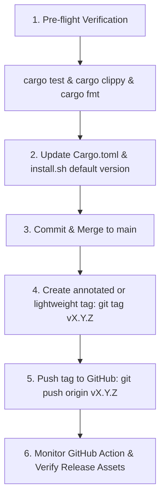

# Rust Binary Release & Installer Workflow

This skill defines the standard architecture for distributing standalone Rust CLI binaries via GitHub Releases with a zero-dependency, POSIX-compliant bootstrap installer (`curl -fsSL ... | sh`).

---

## 1. Supported Architecture & Target Matrix

Every Rust CLI binary in this ecosystem targets two primary platforms without external glibc dependencies:

| Architecture | Platform | Target Triple | Compiler / Toolchain Notes |
| ------------ | -------- | ------------- | --------------------------- |
| **x86_64**   | Debian / Ubuntu / Linux | `x86_64-unknown-linux-gnu` | Default Linux runner target |
| **aarch64**  | ARM64 Linux & Termux (Android) | `aarch64-unknown-linux-musl` | Cross-compiled using `gcc-aarch64-linux-gnu` and `musl-tools` |

> [!IMPORTANT]
> The asset naming convention across both CI and the installer script MUST match:
> `${BIN_NAME}-${TARGET_TRIPLE}.tar.gz`
> Example: `skm-x86_64-unknown-linux-gnu.tar.gz` and `skm-aarch64-unknown-linux-musl.tar.gz`.

---

## 2. Release Configuration Checklist

### 2.1. Cargo.toml Release Profile
Ensure the release profile produces stripped, compact, single-unit binaries:

```toml
[profile.release]
opt-level = "z"     # Optimize for size ('z' or '3')
lto = true          # Link-time optimization
codegen-units = 1   # Maximum size reduction and optimization
panic = "abort"     # Remove unwinding landing pads
strip = true        # Automatically strip debug symbols
```

### 2.2. GitHub Actions Release Workflow (`.github/workflows/release.yml`)
Triggered automatically on version tags (`v*`):

```yaml
name: Release Binaries

on:
  push:
    tags:
      - 'v*'

permissions:
  contents: write

jobs:
  build-release:
    name: Build Release Binary (${{ matrix.target }})
    runs-on: ubuntu-latest
    defaults:
      run:
        shell: bash
    strategy:
      matrix:
        include:
          - target: x86_64-unknown-linux-gnu
          - target: aarch64-unknown-linux-musl

    steps:
      - name: Checkout repository
        uses: actions/checkout@v4

      - name: Install aarch64 cross-linker & musl tools
        if: matrix.target == 'aarch64-unknown-linux-musl'
        run: |
          set -Eeuo pipefail
          sudo apt-get update && sudo apt-get install -y gcc-aarch64-linux-gnu musl-tools

      - name: Install Rust toolchain
        uses: dtolnay/rust-toolchain@stable
        with:
          targets: ${{ matrix.target }}

      - name: Build release binary
        env:
          CARGO_TARGET_AARCH64_UNKNOWN_LINUX_MUSL_LINKER: aarch64-linux-gnu-gcc
        run: |
          set -Eeuo pipefail
          cargo build --release --target ${{ matrix.target }}

      - name: Package binary into tarball
        run: |
          set -Eeuo pipefail
          tar -czf <BIN_NAME>-${{ matrix.target }}.tar.gz -C target/${{ matrix.target }}/release <BIN_NAME>

      - name: Upload asset to GitHub Release
        uses: softprops/action-gh-release@v2
        with:
          files: <BIN_NAME>-${{ matrix.target }}.tar.gz
          make_latest: true
        env:
          GITHUB_TOKEN: ${{ secrets.GITHUB_TOKEN }}
```

### 2.3. Bootstrap Installer Script (`install.sh`)
Place `install.sh` in the repository root. Key requirements:
1. **Strict POSIX (`#!/bin/sh` + `set -e`)**: No Bashisms (no `[[`, `function`, or arrays).
2. **Platform & Termux Detection**:
   - In Termux: checks `$TERMUX_VERSION` or `/data/data/com.termux`, installs into `$PREFIX/bin`.
   - In Linux: installs into `$HOME/.local/bin`.
3. **Architecture Detection**:
   - `x86_64` / `amd64` -> `x86_64-unknown-linux-gnu`
   - `aarch64` / `arm64` -> `aarch64-unknown-linux-musl`
4. **Fallback Mechanism**: Attempts version tag download first (`/download/$VERSION/...`), falls back to `/releases/latest/download/...`.
5. **Path Validation**: Alerts the user if the destination directory is not present in `$PATH`.

---

## 3. Release Execution Protocol

When ready to cut a new release (e.g. `v0.1.0`):



### Step 1: Pre-flight Verification
Run local checks:
```bash
cargo test
cargo clippy --all-targets -- -D warnings
cargo fmt --check
sh -n install.sh
```

### Step 2: Version Synchronization
Ensure the following files agree on the version:
- `Cargo.toml`: `version = "X.Y.Z"`
- `install.sh`: `VERSION="${RELEASE_TAG:-vX.Y.Z}"`

### Step 3: Git Tag & Push
```bash
# On branch main
git tag v0.1.0
git push origin main --tags
```

### Step 4: Verification of the One-Liner
Once the GitHub Action completes successfully, verify installation from an isolated directory:
```bash
curl -fsSL https://raw.githubusercontent.com/<OWNER>/<REPO>/main/install.sh | sh
```
Verify the binary version:
```bash
<BIN_NAME> --version
```

---

## 4. Bundled Templates Reference

This skill includes reusable, parametric templates inside the [`templates/`](templates/) directory:

| Template | Destination in Project | Purpose |
| -------- | ---------------------- | ------- |
| [`templates/release.yml.template`](templates/release.yml.template) | `.github/workflows/release.yml` | Multi-architecture matrix build and GitHub Release asset uploader |
| [`templates/install.sh.template`](templates/install.sh.template) | `install.sh` | One-line POSIX bootstrap installer script |

### Template Placeholders

When applying these templates to a new Rust repository, replace the following variables:

- `{{BIN_NAME}}`: The binary name from `Cargo.toml` `[[bin]]` or `[package].name` (e.g. `skm`, `fa`).
- `{{REPO}}`: The GitHub `owner/repository` slug (e.g. `fusoras/skills-manager`).
- `{{DEFAULT_VERSION}}`: The initial or fallback release version semver (e.g. `0.1.0`).

### Quick Bootstrap Helper

To instantiate both templates in a new repository:

```bash
sed -e 's/{{BIN_NAME}}/skm/g' \
    -e 's/{{REPO}}/fusoras\/skills-manager/g' \
    -e 's/{{DEFAULT_VERSION}}/0.1.0/g' \
    templates/install.sh.template > install.sh
chmod +x install.sh

mkdir -p .github/workflows
sed -e 's/{{BIN_NAME}}/skm/g' \
    templates/release.yml.template > .github/workflows/release.yml
```

