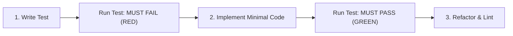

# Test Validator (TDD Protocol)

This skill governs test creation, execution, and verification in the `geico` codebase. It ensures every test is meaningful, reproducible, and incapable of producing false positives.

---

## The First-Run Failure Mandate (Non-Negotiable)

> [!IMPORTANT]
> **Every new test MUST fail on its very first run.**
> If a newly written test passes immediately without touching the implementation, the test is invalid. It indicates either a false positive, a trivial tautology, or that the feature was already implemented. In that case, the test must be adjusted until it genuinely verifies the unfulfilled requirement.

### The 3-Step Lifecycle



---

## Execution Protocol

### Step 1: Write the Failing Test (RED)
1. Identify the specific behavior or edge case to cover.
2. Write the test function with clear naming: `test_<feature>_<scenario>_<expected_result>`.
3. Assert the exact expected output or state change.
4. Run the single test:
   ```bash
   cargo test <test_function_name> -- --nocapture
   ```
5. **Verify the failure**:
   - Confirm the test exits with an error or assertion failure.
   - Note the exact failure message to ensure it failed for the *expected reason*, not due to a syntax or unrelated compile issue.

### Step 2: Implement to Pass (GREEN)
1. Write the minimal production code needed to satisfy the assertion.
2. Re-run the test:
   ```bash
   cargo test <test_function_name> -- --nocapture
   ```
3. Confirm the test now passes cleanly.

### Step 3: Regression & Quality Check (REFACTOR)
1. Run the entire test suite to ensure no regressions:
   ```bash
   cargo test
   ```
2. Verify lints and formatting:
   ```bash
   cargo clippy --all-targets -- -D warnings
   cargo fmt --check
   ```

---

## Testing Guidelines for `geico`

### 1. Isolated Filesystem Testing
Never allow tests to touch real user directories (`~/.local/share/applications`, `~/.local/bin`, or `~/.config`).
- Always use `tempfile::tempdir()` for test workspaces:
```rust
#[test]
fn test_symlink_creation_in_isolated_dir() {
    let temp = tempfile::tempdir().unwrap();
    let bin_dir = temp.path().join("bin");
    std::fs::create_dir_all(&bin_dir).unwrap();
    
    let target = temp.path().join("my-app");
    std::fs::write(&target, "#!/bin/sh\necho hi").unwrap();
    
    // Test logic here using isolated paths...
}
```

### 2. Verify Non-Destructive Invariant
Whenever testing removal (`remove` command), always assert that the original binary still exists after the `.desktop` file and symlink are deleted:
```rust
assert!(target_binary.exists(), "CRITICAL: Target binary must never be deleted!");
```

### 3. Verify Fallback Names
Assert that when `--name` is omitted, the name is correctly derived from the binary filename (e.g. `/path/to/blender-4.2/blender` -> `blender`).
