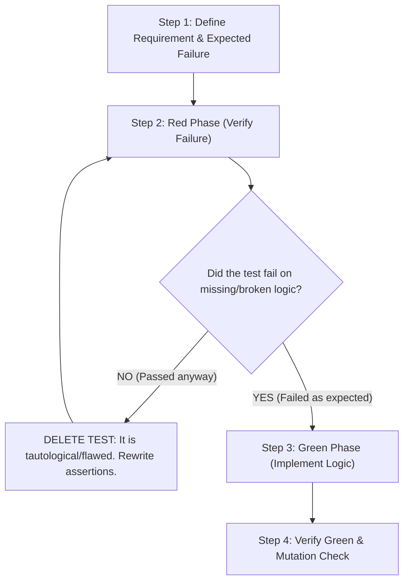

# Strict Testing Protocol (Red-Green Failure Verification)

## 1. Core Mandate: The Non-Negotiable Rule

Every test in `shortcut-sync` must act as an uncompromising gatekeeper of requirements:
1. **Mandatory Failure Verification**: When a requirement is not met, absent, or altered, the test **MUST FAIL**. A test that does not fail when the requirement is broken is completely useless.
2. **Eliminate Non-Failing Tests**: Any test that passes trivially, vacuously, or regardless of whether the business logic is broken must be **immediately eliminated and replaced** with a test that strictly verifies the contract.
3. **Universal Applicability**: This rule applies without exception to every single future test across state, views, events, parsers, generators, and storage.

---

## 2. Standard 4-Step Test Workflow

When adding or updating any test in `shortcut-sync`:

### Step 1: Define the Requirement and Failure Condition
- Clearly identify the contract: input, expected state change, error condition, or UI output.
- Define what constitutes a violation (e.g. key `'a'` not entering `Mode::AddKeys`, or a backup not preserving comments).

### Step 2: Red Phase (Verify Failure)
- Write the test with exact, strict assertions (`assert_eq!`, exact string matches, strict error types).
- Run `cargo test <test_name>` **before** implementing the feature or with the requirement unmet.
- **Verification Criterion**: The test **must fail** with an assertion error that accurately points to the missing requirement.
- **Immediate Rejection**: If the test passes before the requirement is met, **delete the test immediately**. It is a false positive. Rewrite the assertions so they cannot be satisfied without the requirement.

### Step 3: Green Phase (Implement & Pass)
- Implement the minimal, clean code required to satisfy the requirement.
- Run `cargo test <test_name>` and confirm it passes.

### Step 4: Mutation & Sanity Check
- Temporarily tamper with the logic (e.g. change a mode transition, change an output string, disable backup generation).
- Run the test again: confirm it **fails immediately**.
- Restore the correct logic and confirm it passes again.

---

## 3. Anti-Patterns That Must Be Eliminated

| Anti-Pattern | Why It Is Rejected | Required Replacement |
|---|---|---|
| **Vacuous `is_ok()`** | `assert!(res.is_ok())` passes even if the payload is completely empty or wrong. | Inspect the inner payload: `assert_eq!(res.unwrap(), expected_value)`. |
| **Silent wildcard matching** | `_ => {}` in test match blocks silently ignores unexpected states or errors. | Explicitly fail on unexpected branches: `other => panic!("Unexpected state: {:?}", other)`. |
| **Loose substring search** | Checking `text.contains("config")` when multiple unrelated parts contain "config". | Check specific UI rows (`row_text(&terminal, y, w)`) or exact string segments. |
| **Missing side-effect assertion** | Verifying a method returns `true` without checking if disk/state actually updated. | Assert both return value AND filesystem/state persistence (e.g. `path.exists()` and content match). |

---

## 4. Test Categories in `shortcut-sync`

- **TUI State Tests** (`src/tui/state/tests.rs`):
  Verify transitions in `Mode`, multiselect set operations, filter reductions, and cursor bounds.
- **TUI Views Tests** (`src/tui/views/tests/`):
  Render against `TestBackend`, inspect cell colors and exact symbols via `backend_text` and `row_text`.
- **TUI Events Tests** (`src/tui/events/tests/`):
  Simulate synthetic `KeyEvent` and `MouseEvent`, verify routing, scrolling, and action dispatching.
- **Storage & Backup Tests** (`src/core/storage/tests.rs`):
  Use `TempConfigGuard`, verify 3-way merge resolutions, `.meta` sidecars, and comment preservation.
- **Parser & Generator Tests** (`src/core/parser/`, `src/core/generator/`):
  Assert AST round-trips, modifier order normalization, and delimiter boundaries.
